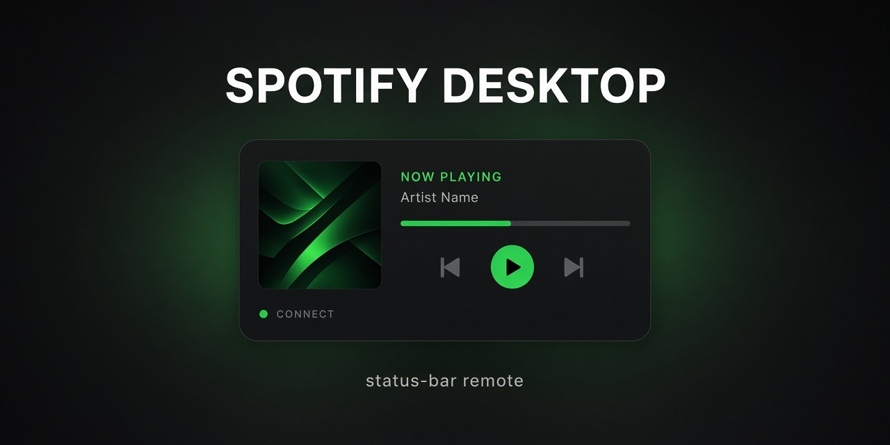

# spotify-desktop

<p align="center">
  
</p>


A Spotify **remote** for Hermes Desktop: a mini player in the status bar plus a
picker popover. Audio keeps playing through your Spotify apps (Spotify
Connect) — the desktop app cannot decrypt Spotify's DRM stream, so this plugin
drives your devices instead of replacing them.

## What you get

- Status bar chip: now playing (track — artist) with a live equaliser, play/pause, next
- Popover panel, tinted with a colour picked from the current album cover:
  - **Player** — artwork, ♥ save to Liked Songs, draggable seek bar, shuffle /
    previous / play-pause / next / repeat (incl. repeat-one), volume with mute,
    device transfer list. Click the title to browse its album, the artist to
    browse their releases (Shift-click either to open the Spotify app). When
    Spotify drops an idle session the player keeps the last track — also across
    restarts — and Play restarts it on your device.
  - **Library** — recently played, Liked Songs, your playlists; drill into a
    playlist, album or artist and play any track in its context. `Esc` goes back.
  - **Search** — songs, artists, albums and playlists with filter chips; the
    query survives tab switches
  - **Queue** — now playing and what's next
- Optional song-change notifications (bell icon, bottom right) with a **Next** button;
  shown by the OS only while Hermes is in the background
- Sign-in banner when the Spotify token is revoked; automatic back-off on 429 rate limits
- Keyboard, with the panel focused: `Space`/`K` play-pause · `N`/`P` next/previous ·
  `L` like · `S` shuffle · `R` repeat · `M` mute · `+`/`-` volume · `1`–`4` tabs ·
  `/` search · `Esc` back
- Global shortcuts (rebindable in Settings ▸ Keyboard): `Ctrl+Alt+Space` play/pause,
  `Ctrl+Alt+]` next, `Ctrl+Alt+[` previous
- Command palette (`Ctrl+K`, type "spotify"): play/pause, next, previous, like,
  volume up/down, shuffle, open in the Spotify app
- Motion: panel pop-in, sliding tab pill, directional slide for drill-downs,
  staggered list rows, album-art and title cross-fade on track change, heart pop
  with ring on like, play/pause icon morph and pulse while playing, smooth
  progress fill, spinning refresh icons. All of it is off under
  `prefers-reduced-motion`.
- Polls every 4s with the popover open, 12s closed (24s idle), plus an immediate
  refresh when a track ends

## Tests

- `tests/test_plugin_api.py` — backend routes against a fake Spotify client
  (`pytest tests/`)
- `tests/ui.test.mjs` — mounts `desktop/plugin.js` with React + jsdom and a fake
  backend and clicks through every view
  (`npm i react react-dom jsdom && node tests/ui.test.mjs desktop/plugin.js`)
- `tests/visual.mjs` — renders the panel in headless Chrome, captures mid-animation
  frames to `shots/`, and asserts which animations ran and that reduced motion
  disables them (`npm i react react-dom playwright-core esbuild && node tests/visual.mjs desktop/plugin.js`)

## What this plugin touches

- **Network:** only the Spotify Web API (`api.spotify.com`), through the official
  `spotify` plugin's client. Album covers load from Spotify's image CDN
  (`i.scdn.co`) in the Desktop renderer, which also samples the cover's colour
  for the panel tint.
- **Credentials:** none of its own. It never reads `auth.json` itself; the
  `spotify` plugin's client supplies and refreshes the token.
- **Your library:** the ♥ button writes to your Liked Songs (`PUT`/`DELETE /me/library`)
  only when you click it.
- **Local data:** the last played track and the notification toggle are kept in
  the Desktop plugin storage (`ctx.storage`).
- **Notifications:** off by default; when you turn them on they use the Desktop
  OS notification door and only show while Hermes is in the background.
- No shell commands, no background processes beyond the in-app poll, no telemetry.

## How it works

```
spotify-desktop/
├── dashboard/
│   ├── manifest.json     ← discovered by the web server (name + api mount)
│   └── plugin_api.py     ← FastAPI router mounted at /api/plugins/spotify-desktop/ (backend only — no web UI)
├── desktop/
│   └── plugin.js         ← the Hermes Desktop mini player (runtime door contract)
└── README.md
```

- `dashboard/plugin_api.py` reuses the Hermes **Spotify client** from the
  official `spotify` plugin (or, on older Hermes releases, the copy bundled in
  core as `plugins.spotify.client`) — token refresh, 401 retry, and error
  mapping come from the Hermes Spotify integration. No credentials are handled here.
- `desktop/plugin.js` follows the desktop runtime-plugin contract (default
  `HermesPlugin` export; imports only `@hermes/plugin-sdk`, `react`,
  `react/jsx-runtime`) and reads the API above via `ctx.rest`.

## Install

**Option A — Install from Git (GUI, both halves):** paste this repo's URL into
Settings ▸ Plugins ▸ **Install from Git**. The probe recognizes the unified
package and offers two checkboxes:

- **Desktop UI** — copies `desktop/` into the app's `desktop-plugins/` folder
- **Agent plugin** — installs the package into the profile's `plugins/` root
  (this is what carries `dashboard/plugin_api.py`) and enables it
  (`plugins.enabled`); accepting both materializes the desktop half from the
  installed package (no duplicate copies)

When the restart prompt appears, take it — the backend API mounts at startup.

**Option B — manual:**

1. Copy this folder into the Hermes plugins root:

   - Windows: `%LOCALAPPDATA%\hermes\plugins\spotify-desktop`
   - Linux/macOS: `~/.hermes/plugins/spotify-desktop`

   ```bash
   git clone https://github.com/cruzlxyz/hermes-spotify-desktop <HERMES_HOME>/plugins/spotify-desktop
   ```

2. Enable it (the user-plugin trust gate requires it before the backend API
   mounts):

   ```bash
   hermes plugins enable spotify-desktop
   # or add `spotify-desktop` under plugins.enabled in config.yaml
   ```

3. Restart Hermes Desktop. The desktop half is materialized automatically from
   `plugins/spotify-desktop/desktop/plugin.js` into `desktop-plugins/`, then
   enable **Spotify** in Capabilities ▸ Plugins if it is not already on.

4. Spotify auth: see [Spotify auth](#spotify-auth-one-time) below — it is
   independent of the install and can be done in either order.

## Spotify auth (one-time)

Install and Spotify auth are **independent** — do them in either order. The
plugin never touches credentials itself: it reads whatever Hermes already has
in `~/.hermes/auth.json` (`providers.spotify`), so once you log in, the player
starts working on its next poll — no restart needed.

```bash
hermes plugins install spotify   # the official Spotify plugin (Hermes releases after Spotify left core)
hermes spotify login             # login wizard
hermes spotify status            # verify
```

On older Hermes releases that still bundle Spotify in core, the commands are
`hermes auth spotify` / `hermes auth status spotify` and no install is needed.

Spotify does not allow public third-party OAuth apps, so **every user creates
their own free Spotify developer app** during the wizard: any name and
description, leave the website field blank, add the redirect URI
`http://127.0.0.1:43827/spotify/callback`, and enable the **Web API** product.
Only the Client ID is required — PKCE uses no client secret. The refresh token
lives ~6 months; re-run the wizard if it gets revoked.

**What works without Premium:** search, playlists, library, device list, and
read-only playback state. **Premium** is required for the mutations this
remote is built for: play / pause / skip / seek / repeat / shuffle / volume /
queue-add / device transfer.

Troubleshooting quick hits: `403 no active device` → open Spotify on any
device first; `403 Premium required` → Free account calling a mutation; `204`
→ nothing is playing (normal, not an error); `429` → Spotify rate limit,
resets in ~30 seconds; repeated `401` → refresh token revoked, re-run
`hermes spotify login`.

## Configuration

Settings live under `plugins.entries.spotify-desktop.settings` in `config.yaml`
(the official Hermes plugin-settings mechanism — all optional, sensible
defaults apply when the block is absent):

```yaml
plugins:
  enabled: [spotify-desktop]
  entries:
    spotify-desktop:
      settings:
        poll_interval_open: 4     # seconds between polls while the popover is open
        poll_interval_closed: 12  # seconds while closed
```

No environment variables are required — Spotify auth piggybacks on Hermes's
PKCE login (`hermes spotify login`). The schema is declared in `plugin.yaml`
(`config_schema:`), so the loader warns about invalid values.

## Package structure

The package has two halves, each running in its own runtime:

| Folder | Runs in | What it is |
|---|---|---|
| `desktop/` | Hermes Desktop (Electron) | The status-bar mini player — the whole product |
| `dashboard/` | Hermes backend (Python) | The REST API (`plugin_api.py`) the player reads — no web UI ships here |

**Why is it called `dashboard/`?** Not a legacy name: Hermes requires every
plugin with a backend HTTP API to keep it in a `dashboard/` folder — the web
server only discovers `<name>/dashboard/manifest.json` and only mounts API
files inside that directory. The name comes from Hermes' backend process,
which doubles as its web-dashboard server.

**Desktop-focused by default.** `dashboard/manifest.json` sets
`"tab": { "hidden": true }` — an official manifest option that keeps the
plugin registered and its API mounted while adding nothing to the web
dashboard. The API routes stay reachable at `/api/plugins/spotify-desktop/*`
for anyone who wants to build their own browser remote (a full one exists in
git history at commit `20099d7`).

**Removing the desktop player** (rare): delete the `desktop/` folder — the
backend API keeps working. Removing `dashboard/`, however, is not possible:
the player reads its data from `/api/plugins/spotify-desktop/*`, which only
mounts through that folder. With the tab hidden, the web side is already
fully "gone".

## Notes

- No client secrets, no extra OAuth flow — the plugin piggybacks on Hermes's
  PKCE login (`providers.spotify` in `auth.json`).

## Compatibility note

The dashboard backend reuses the Hermes **Spotify plugin** for auth:
`dashboard/plugin_api.py` imports its `spotify_client` module from the loaded
`spotify` plugin, falling back to `plugins.spotify.client` on Hermes releases
that bundle Spotify in core (token refresh, the 401 retry, and error mapping),
and the private `_plugin_settings_entry` helper
from `hermes_cli.plugins` (settings lookup). These are internal seams that can
move between Hermes releases — if a Hermes update breaks them, this plugin
follows upstream shortly after. Everything else is self-contained.

